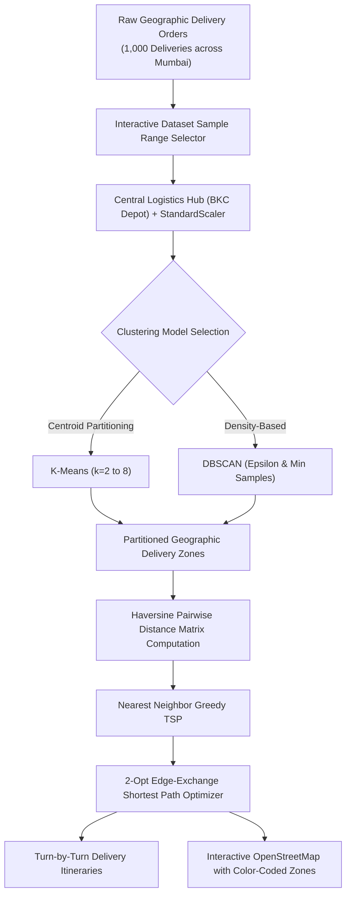

# Smart Delivery Zones: Mumbai Routing & Shortest Path Optimization

An applied Machine Learning and Combinatorial Optimization mini-project for fleet route planning in the Mumbai Metropolitan Region.

---

## 💻 Quick Setup & System Requirements (Run on Any Device)

### 1. Prerequisites
* **Python**: Python 3.9, 3.10, 3.11, 3.12, or 3.13 installed.
* **Git**: (Optional) to clone the repository.
* **Operating System**: Windows, macOS, or Linux.

### 2. Required Libraries
* `numpy`: Vectorized Euclidean and Haversine distance computations.
* `pandas`: Delivery dataset storage, itinerary generation, and tabular manipulations.
* `scipy`: Scientific calculations and geographic spatial tools.
* `matplotlib`: High-resolution static route map figures.
* `networkx`: Graph structures and path analysis.
* `folium`: Interactive OpenStreetMap HTML map generation with pins and polylines.
* `streamlit`: Interactive web UI dashboard with live filters and sliders.

### 3. One-Click Installation Commands
Run either of the following commands in your terminal or PowerShell inside the project directory:

**Using `requirements.txt` (Recommended):**
```bash
pip install -r requirements.txt
```

**Or install directly in one line:**
```bash
pip install numpy pandas scipy matplotlib networkx folium streamlit
```

*(On Windows, you can also use `py -m pip install -r requirements.txt`)*

### 4. Running the Project
* **To launch the Interactive Web Dashboard:**
  ```bash
  streamlit run app.py
  ```
  *(Or `py -m streamlit run app.py`)*
* **To run the full Command-Line Pipeline:**
  ```bash
  python main.py
  ```
  *(Or `py main.py`)*

## 📌 Executive Summary

Solving routing for delivery packages across a major metropolis like Mumbai poses an $NP\text{-hard}$ challenge (the Traveling Salesperson / Vehicle Routing Problem). Searching for the absolute global shortest path across the entire city scales with factorial time complexity $\mathcal{O}(n!)$, making raw graph traversal computationally prohibitive.

This project implements a **Cluster-First, Route-Second** architecture:
1. **Unsupervised Machine Learning (Clustering)**: Decomposes the large city-wide point cloud into geographically coherent delivery zones.
2. **Shortest Path Graph Optimization**: Computes turn-by-turn optimal Hamiltonian delivery circuits from a central distribution depot (Bandra-Kurla Complex / BKC) through each cluster.

---

## 🎯 Algorithms & Techniques Applied

| Domain | Algorithm / Technique | Purpose in this Project |
| :--- | :--- | :--- |
| **Data Scaling** | **Custom StandardScaler** | Normalizes GPS coordinates (Latitude, Longitude) to eliminate feature distortion. |
| **Clustering** | **K-Means Clustering** (Lloyd's + K-Means++) | Partitions delivery points into balanced, convex geographic zones with defined boundaries. |
| **Clustering** | **DBSCAN** | Density-based spatial clustering to discover dense urban corridors and isolate outlier/noise deliveries. |
| **Validation** | **Elbow Method (Inertia / WCSS)** | Evaluates Within-Cluster Sum of Squares to locate the point of diminishing returns when choosing $k$. |
| **Validation** | **Silhouette Analysis** | Measures how well separated the delivery zones are ($s \in [-1, 1]$). |
| **Shortest Path** | **Dijkstra's Algorithm** | Single-source shortest path traversal with priority queue. |
| **TSP Routing** | **Greedy Nearest Neighbor** | Initial closed tour construction starting from and returning to the BKC Central Depot. |
| **Path Optimization** | **2-Opt Edge-Exchange Local Search** | Untangles overlapping paths to obtain the true minimal-distance circuit for each truck. |

---

## 🏗️ System Architecture & Workflow



---

## 🗺️ Mumbai Synthetic Dataset (1,000 Entries)

The synthetic dataset represents **1,000 delivery drops + 1 Central Logistics Depot** distributed realistically across key geographic sectors of Mumbai:

* **Central Logistics Hub (Depot):** Bandra-Kurla Complex (BKC) `[19.0657° N, 72.8687° E]`
* **South Mumbai Sectors:** Colaba, Nariman Point, CSMT / Fort, Malabar Hill, Byculla, Worli / Lower Parel.
* **Central Suburbs:** Kurla, BKC, Ghatkopar, Bhandup, Mulund, Powai.
* **Western Suburbs:** Bandra West, Vile Parle, Andheri East (SEEPZ), Andheri West (Lokhandwala), Goregaon, Malad, Kandivali, Borivali.
* **Eastern Corridors:** Vashi (Navi Mumbai), Thane West.

### Dataset Attributes (`data/mumbai_deliveries.csv`):
* `order_id`: Unique identifier (e.g., `MUM-0342`).
* `customer_name`: Recipient name.
* `area`: Locality in Mumbai.
* `latitude`, `longitude`: Exact decimal degree GPS coordinates.
* `package_weight_kg`: Package weight (0.5 kg to 12.0 kg).
* `time_window`: Delivery slot (e.g., `09:00 - 12:00`).
* `priority`: Priority classification (`Standard`, `High`, `Express`).
* `is_depot`: Flag indicating the BKC dispatch depot.

---

## 🧮 Mathematical Methodology & Algorithms Used

### 1. Great-Circle Distance (Haversine Formula)
To measure physical road-approximation distances between two coordinates $(\phi_1, \lambda_1)$ and $(\phi_2, \lambda_2)$ on Earth:
$$d = 2R \arcsin \left( \sqrt{\sin^2\left(\frac{\Delta \phi}{2}\right) + \cos(\phi_1)\cos(\phi_2)\sin^2\left(\frac{\Delta \lambda}{2}\right)} \right)$$
where Earth radius $R = 6371.0\text{ km}$.

### 2. K-Means Clustering (Lloyd's Algorithm + K-Means++)
Minimizes the Within-Cluster Sum of Squares (WCSS / Inertia):
$$J = \sum_{k=1}^{K} \sum_{x_i \in C_k} ||x_i - \mu_k||^2$$
* Initialized using **K-Means++** to prevent poor local minima.
* Creates distinct, balanced clusters ideal for assigning one delivery vehicle per zone.

### 3. DBSCAN (Density-Based Spatial Clustering)
Discovers clusters of arbitrary shape based on spatial density:
* Connects core points with at least `min_samples` neighbors within radius $\varepsilon$.
* Points in low-density or isolated fringes are flagged as noise ($-1$).

### 4. Shortest Path Optimization: 2-Opt Edge-Exchange
* **Nearest Neighbor TSP**: Starts at BKC depot, greedily visits the closest unvisited stop, and returns to BKC.
* **2-Opt Local Search**: Takes pairs of non-adjacent route segments $(u, u+1)$ and $(v, v+1)$ and reverses the sub-tour between them if:
$$d(u, v) + d(u+1, v+1) < d(u, u+1) + d(v, v+1)$$
This removes crossing lines and guarantees the shortest Hamiltonian circuit within each zone.

---

## 🎨 Zone Color Legend Mapping

In both the CLI output, CSV summaries, and the Streamlit Web UI, each delivery zone is mapped to a distinct color for immediate recognition:

| Zone | Route Color | Hex Code | Description |
| :---: | :---: | :---: | :--- |
| **Zone 0** | 🔴 Red | `#E63946` | Western Suburbs / Bandra–Andheri |
| **Zone 1** | 🔵 Deep Blue | `#1D3557` | South Mumbai / Marine Lines |
| **Zone 2** | 🟢 Teal / Green | `#2A9D8F` | Central / Ghatkopar / Powai |
| **Zone 3** | 🟠 Orange | `#F4A261` | Northern / Borivali / Thane |

---

## 🚀 How to Run the Project

### 1. Launch the Interactive Web Dashboard
```bash
py -m streamlit run app.py
```
Open `http://localhost:8501`. 
* In the **Raw Dataset & Sample Filter** tab, use the slider to dynamically change the number of orders (e.g., from 50 to 500) to see routes update on the map in real time!
* In the **Route Map & Overview** tab, inspect the color-coded legend table and interactive map.

### 2. Run from Terminal (CLI Pipeline)
```bash
py main.py
```

### 3. Open Interactive HTML Map Directly
Open [outputs/mumbai_route_map.html](file:///c:/Users/aryan/Desktop/CODES/ML-Mini-Project/outputs/mumbai_route_map.html) in your browser.